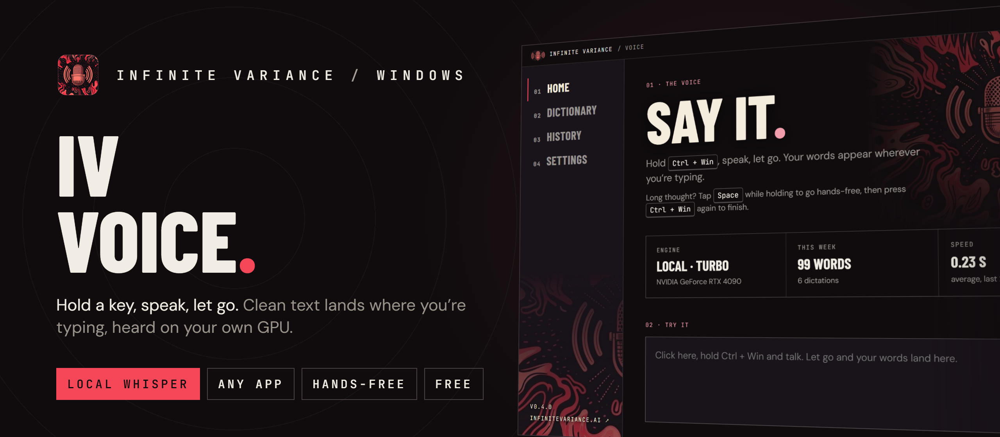
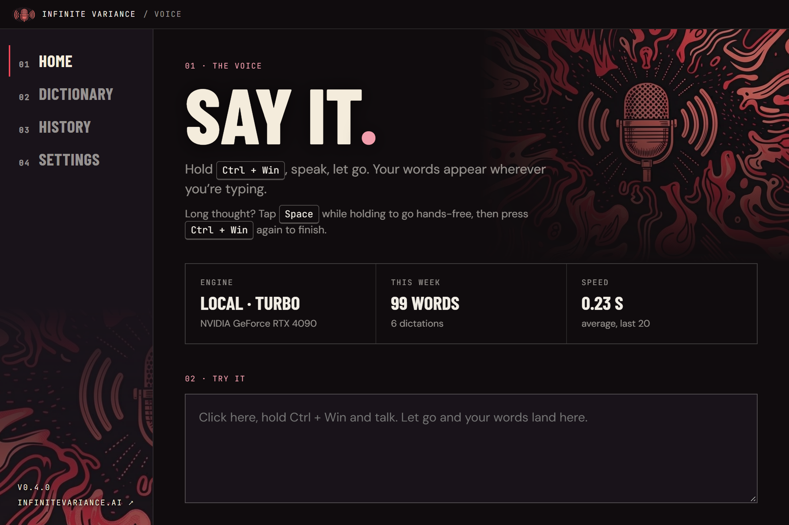
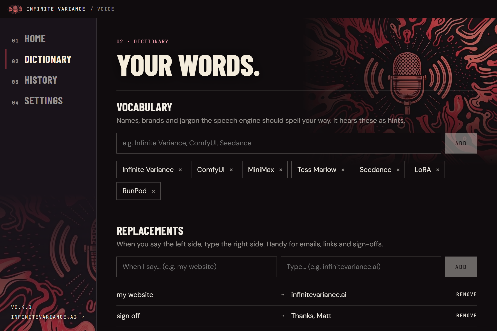
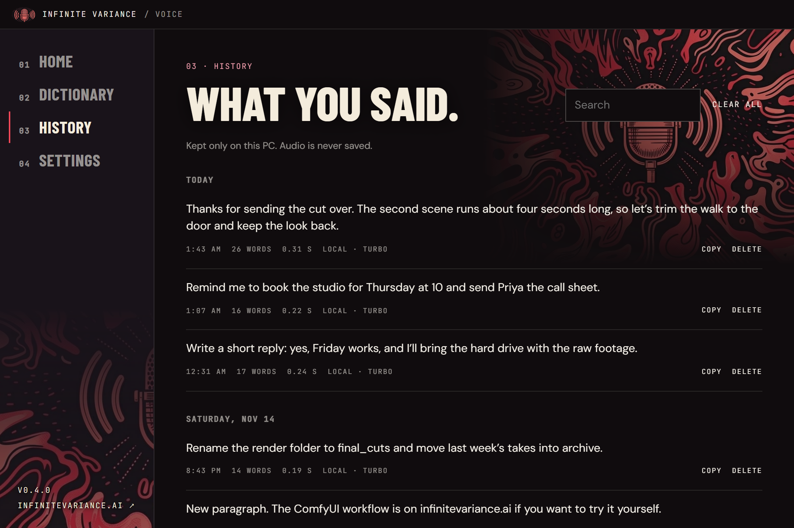
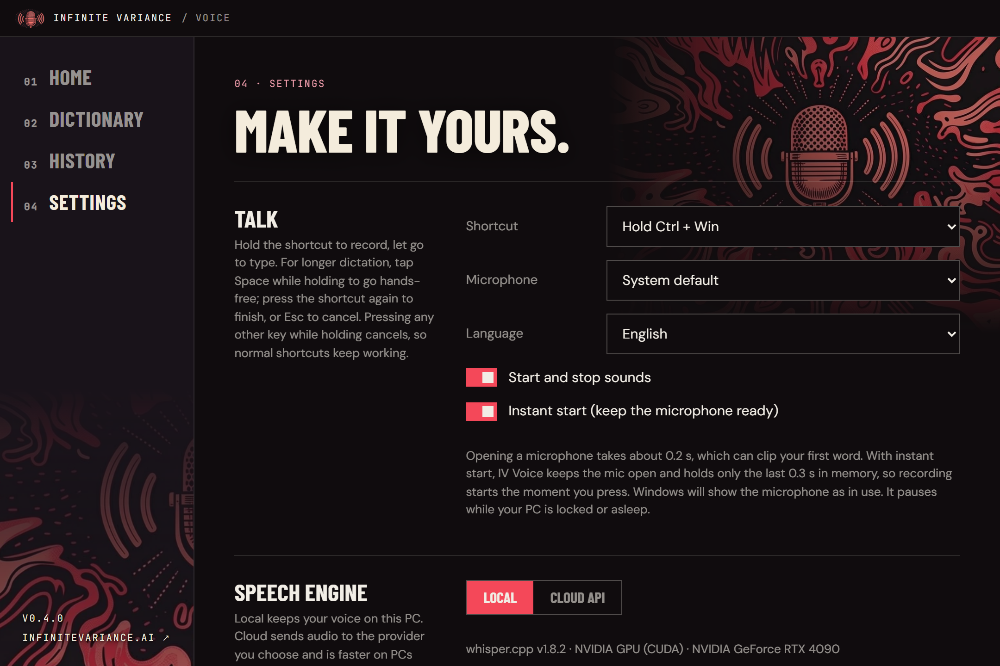

<p align="center">
  
</p>

<p align="center">
  <a href="https://github.com/hollisorg/iv-voice/releases/latest/download/IV-Voice-Setup.exe"><b>Download for Windows</b></a>
  &nbsp;·&nbsp;
  <a href="#what-you-need">What you need</a>
  &nbsp;·&nbsp;
  <a href="https://github.com/hollisorg/iv-voice/releases/latest">Release notes</a>
  &nbsp;·&nbsp;
  <a href="https://infinitevariance.ai">Infinite Variance</a>
</p>

# IV Voice

A free Infinite Variance voice dictation app for Windows. Hold a shortcut, speak, let go, and clean text
appears wherever you're typing: email, Slack, docs, prompts, code comments. Speech recognition runs
**locally on your GPU** with [whisper.cpp](https://github.com/ggml-org/whisper.cpp) and OpenAI's Whisper
large-v3 turbo model, so your voice never leaves the PC. PCs without a capable GPU can use the CPU build, or
bring their own Groq or OpenAI API key.

<p align="center">
  
</p>

## What it does

- **Hold, speak, let go.** Hold the shortcut (Ctrl + Win to start with), talk, and let go. A small pill
  shows it's listening, then types your words into the app you were already in. It never takes focus.
- **Hands-free for long thoughts.** Tap Space while holding to lock it on, let go and keep talking, then
  press the shortcut again to finish. Esc cancels.
- **Your first word isn't clipped.** Instant start keeps the microphone ready with a 0.3-second rolling
  buffer, so recording begins the moment you press. It pauses while the PC is locked or asleep, and you
  can turn it off.
- **On your own GPU.** Whisper large-v3 turbo through whisper.cpp's CUDA build. On an RTX 4090 a clip
  comes back in about a tenth of a second. The engine stops after an idle time you choose, so it frees
  GPU memory for ComfyUI and other tools.
- **Clean text.** Filler words and silence artefacts are removed, and saying "new line" or "new paragraph"
  makes a break.
- **Your words, spelled right.** The Dictionary passes names, brands and jargon to Whisper as hints, and
  replacements turn what you say into what you mean ("my website" becomes infinitevariance.ai).
- **History you can search.** Every dictation, with its words, speed and engine, kept only on your PC.
  Copy or delete any of them. The audio itself is never saved.
- **Your clipboard comes back.** IV Voice pastes through the clipboard and then puts back whatever was on
  it, in every format.
- **Other apps can drive it.** A local control pipe lets apps like [IV Keys](https://github.com/hollisorg/iv-keys)
  start, stop and paste dictation (see [Control it from other apps](#control-it-from-other-apps)).
- **Stays in the tray and updates itself**, like the other IV apps.

<p align="center">
  
  &nbsp;
  
  &nbsp;
  
</p>
<p align="center"><sub>The pill: listening, locked hands-free, and typing</sub></p>

<table>
  <tr>
    <td width="50%"></td>
    <td width="50%"></td>
  </tr>
  <tr>
    <td align="center"><sub>Dictionary: words to spell your way, and replacements</sub></td>
    <td align="center"><sub>History: what you said, kept only on your PC</sub></td>
  </tr>
  <tr>
    <td width="50%"></td>
    <td width="50%">
      <b>Settings</b> picks the shortcut (Ctrl + Win, Right Alt, Right Ctrl or Ctrl + Shift + Space), the
      microphone and language, sounds, instant start and launch at login; the speech engine (local, or a
      cloud API with your own key) and its model; how long the engine stays loaded; the clean-up rules; and
      updates.
    </td>
  </tr>
</table>

## What you need

- **Windows 10 or 11**, 64-bit.
- **A microphone.**
- **For local speech recognition:** an NVIDIA GPU for the fast Turbo model, or any PC for the CPU build
  with the Small model. Or skip the download and use your own **Groq** or **OpenAI** API key (any
  OpenAI-compatible transcription endpoint works).

## Install

1. [Download `IV-Voice-Setup.exe`](https://github.com/hollisorg/iv-voice/releases/latest/download/IV-Voice-Setup.exe)
   (about 115 MB).
2. Run it. The installer isn't code-signed yet, so Windows may show **"Windows protected your PC"**.
   Click **More info → Run anyway**. It installs for your user only; no admin rights needed.
3. Open IV Voice. **Home** offers a one-click setup that picks the right engine for your PC:

   | PC | Downloads | Total |
   |---|---|---|
   | NVIDIA GPU | whisper.cpp CUDA 12 build + Turbo model | ~1.3 GB |
   | No NVIDIA GPU | whisper.cpp CPU build + Small model | ~200 MB |

   Every file is verified before it's used: the engine against GitHub's published SHA-256 digest and the
   model against Hugging Face's LFS SHA-256. They're stored in `%APPDATA%\IV Voice\engine` and `\models`.
4. Click into any text box, hold **Ctrl + Win**, speak, and let go.

IV Voice checks for updates when it opens and every six hours, and installs a downloaded update when you
quit. **Settings → Updates** shows where it stands.

## How it works

1. **Shortcut** (`src/main/hotkey.js`): a low-level keyboard hook (uiohook-napi), because
   Electron's global shortcuts have no key-up event. Holding the combo records and releasing it
   finishes. Tap Space while holding to lock into hands-free mode, then press the combo again to
   finish (Esc cancels). Pressing any other key while holding cancels, so shortcuts like Ctrl+Win+D
   still work.
2. **Microphone** (`src/renderer/src/recorder.js`, inside the floating pill window): 16 kHz mono
   capture, live waveform, encoded as WAV. Near-silent or very short clips are dropped, because
   Whisper invents text from silence.
3. **Speech to text**:
   - **Local** (`src/main/whisper.js`): whisper.cpp's `whisper-server` on localhost with the model
     kept loaded. On an RTX 4090 the first clip took 2.7 s (model load) and later clips about 0.1 s.
     It stops after an idle period you choose, to free GPU memory for ComfyUI and other tools.
   - **Cloud** (`src/main/cloud.js`): any OpenAI-compatible `/audio/transcriptions` endpoint. The
     key is encrypted with Windows DPAPI (Electron `safeStorage`) and never reaches the UI.
   - **Dictionary words** are passed to Whisper as hints, so names and jargon come out spelled right.
4. **Cleanup** (`src/main/cleanup.js`): removes filler words and silence artefacts, turns "new line"
   and "new paragraph" into breaks, and applies your replacements ("my website" → infinitevariance.ai).
5. **Typing** (`src/main/insert.js`): saves your clipboard, pastes with a simulated Ctrl+V, then
   puts your clipboard back.

The pill window can't take focus, so the text lands in the app you were using. Windows run
sandboxed with context isolation. The only permissions granted are the microphone and clipboard writes.

History, dictionary and settings are JSON files in `%APPDATA%\IV Voice`. Audio is never saved.

## Control it from other apps

IV Voice listens on a local named pipe, `\\.\pipe\iv-voice-<your Windows username>`. Send one JSON
object per line:

```
{"cmd":"toggle"}     start hands-free dictation, or finish the current one
{"cmd":"start"} {"cmd":"stop"} {"cmd":"cancel"}
{"cmd":"paste-last"} type the most recent dictation again
{"cmd":"status"}     -> {"ok":true,"state":"idle|recording|working","locked":false}
{"cmd":"subscribe"}  keep the connection open; a status line arrives on every change
```

Code is in `src/main/control.js`. [IV Keys](https://github.com/hollisorg/iv-keys) uses it for its Voice button.

## Develop

```bash
npm install
node node_modules/electron/install.js   # npm 11 skips Electron's install script
npm run dev
```

Run these from your own terminal. Apps started from the Claude desktop app's shell have their
AppData redirected into Claude's package folder.

`npm run dist` writes `dist\IV-Voice-Setup.exe`, a per-user NSIS installer. Releases, code signing and
auto-updates work the same way as IV Downloader; see `docs/RELEASING.md` and `docs/CODE-SIGNING.md`.

## Known limits

- With Instant start turned off, the first ~0.1–0.2 s after pressing is lost while the microphone
  opens.
- Apps running as administrator don't accept simulated input from a normal app, so pasting into
  them fails. Windows blocks this on purpose.
- Windows only for now.

## Licence

MIT (see `LICENSE`). Third-party components are listed in `THIRD_PARTY_NOTICES.txt`.
libuiohook, inside the keyboard-hook module, is LGPL-3.0 and ships as a separate, replaceable file.

The screenshots show invented dictations and settings.

## Signed Windows release builds

Run `npm run dist:win-release` on Windows to stage a signed installer, blockmap, and updater
manifest in `dist/`. Use the Hollis Azure tenant in Azure CLI, with the .NET 10 x64 runtime
and Windows SDK 22621 or newer installed. The release build checks the publisher, timestamp,
and updater checksum before it succeeds. `npm run dist` is for unsigned development builds.
